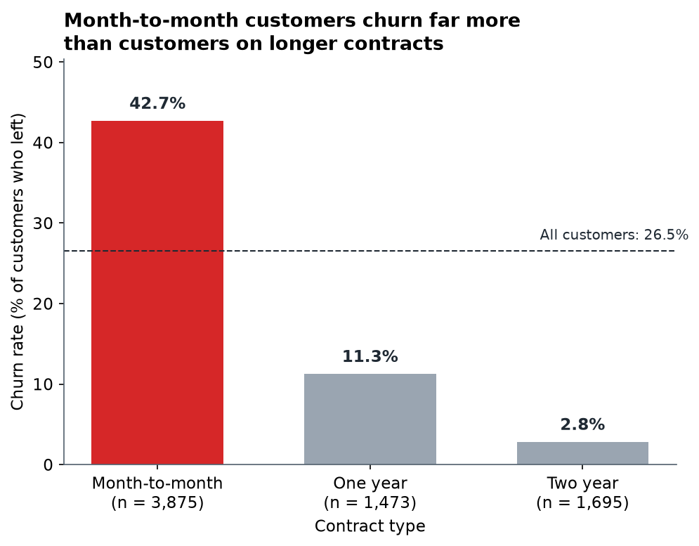
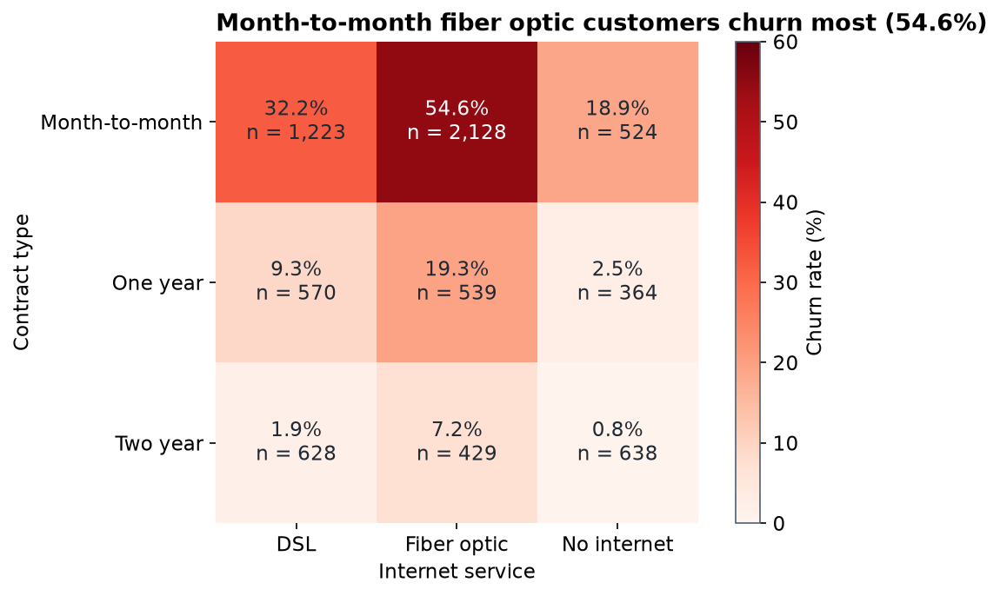
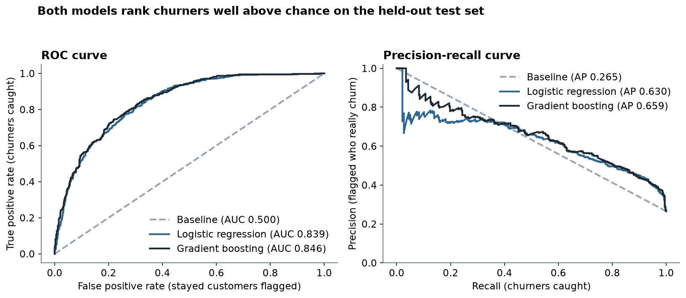
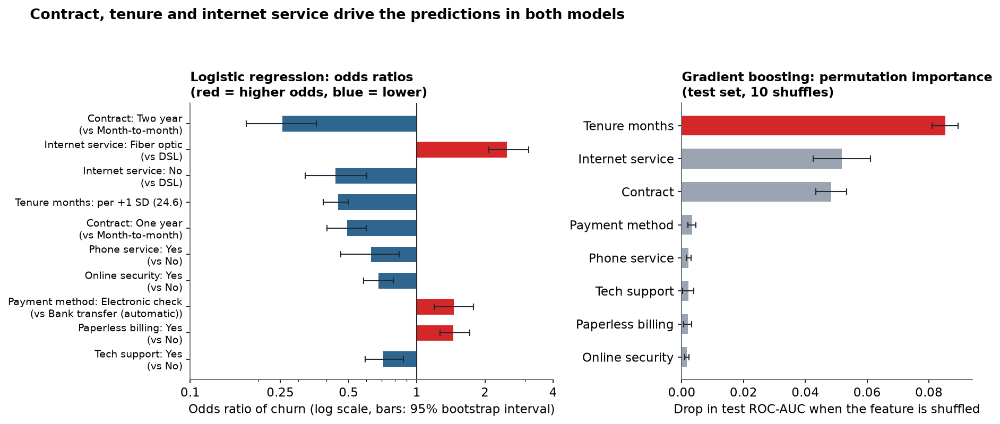
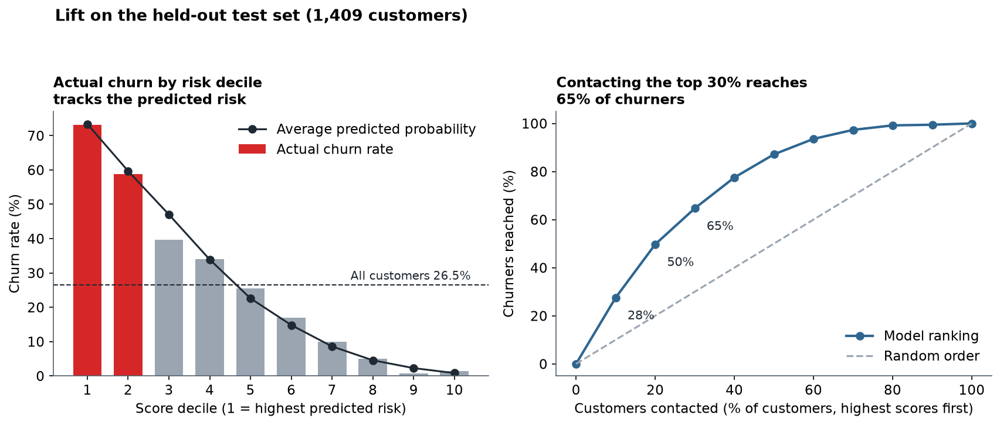

# Telco Customer Churn Analysis

A Python analysis of why telecom customers leave, and a model that ranks current customers by churn risk. Built on a public sample dataset, so results describe this dataset, not a real company.

## Business problem

A telecom company is losing customers. The retention manager wants to know:

1. How many customers leave, and how much monthly revenue leaves with them?
2. Which customer groups have the highest churn (contract, tenure, services, payment method, price)?
3. Which differences are large enough to be real and not just chance?
4. Can we predict which current customers are most at risk?
5. What should the company do first to reduce churn?

## Dataset

IBM Telco Customer Churn sample dataset: 7,043 customers, 21 columns, 26.54% churned. Source, licence and download steps: [data/README.md](data/README.md). The raw and processed data files are not stored in the repository; `python run_project.py` downloads and checks the file.

## Skills demonstrated

- **Python, pandas:** data inspection, cleaning with 30 automatic validation checks, group and segment analysis.
- **Statistics (scipy):** chi-square and Mann-Whitney tests, effect sizes (Cramér's V, rank-biserial), Holm multiple-testing correction.
- **Machine learning (scikit-learn):** pipelines without leakage, stratified split and cross-validation, logistic regression and gradient boosting, ROC/PR evaluation, threshold choice, calibration and lift, odds ratios and permutation importance.
- **Communication (matplotlib, Markdown):** charts, a findings report with recommendations and a measurement plan, model notes and stated limitations.
- **Reproducibility:** one command rebuilds every table and chart.

## Headline findings

These are associations in this dataset, not proven causes.

1. **26.54% of customers churned** (1,869 of 7,043), and they carry 30.50% of monthly charges ($139,130.85 of $456,116.60).
2. **Contract and tenure matter most.** Month-to-month customers churn at 42.71% vs 2.83% for two-year contracts; customers in their first year churn at 47.44% vs 9.51% for customers with 49 to 72 months.
3. **Fiber optic is a hotspot.** Fiber churns at 41.89% vs 18.96% for DSL, and month-to-month fiber customers churn at 54.61% (62.17% of all churners). The fiber gap stays after adjusting for the other features (odds ratio 2.50).
4. **A simple model ranks risk well.** Logistic regression: test ROC-AUC 0.839 (baseline 0.500). Contacting the top 30% of customers by score would reach 64.7% of churners.





## Model results

Held-out test set: 1,409 customers (374 churners). Cross-validation (CV): 5-fold, training set only. Precision and recall at threshold 0.5.

| Model | CV ROC-AUC | Test ROC-AUC | Test PR-AUC | Accuracy | Precision | Recall |
|---|---|---|---|---|---|---|
| Baseline (always "stayed") | 0.500 +/- 0.000 | 0.500 | 0.265 | 73.5% | 0 | 0 |
| Logistic regression (final) | 0.845 +/- 0.012 | 0.839 | 0.630 | 79.7% | 63.6% | 55.1% |
| Gradient boosting | 0.850 +/- 0.012 | 0.846 | 0.659 | 80.4% | 67.0% | 51.6% |

Accuracy alone misleads here: 73.5% of customers stay, so doing nothing is 73.5% accurate. With the chosen threshold of 0.35 (picked on training data to catch about 70% of churners with a low-cost offer in mind), the logistic regression finds 70.6% of churners with 54.4% precision and flags 34.4% of customers.







Risk tiers for the 5,174 customers who had not churned (scored out-of-fold): 997 High, 959 Medium, 3,218 Low. Estimated monthly charges at risk: $67,869.98, of which $41,288.68 is in the High tier. This is an estimate, not a forecast; see [docs/model_notes.md](docs/model_notes.md).

## Read more

- [Findings and recommendations](reports/findings.md)
- [Model notes](docs/model_notes.md): method, feature decisions, threshold, what the model should not be used for
- [Analysis notes](docs/analysis_notes.md): exploratory analysis and statistical tests
- [Data quality report](reports/data_quality.md) and [data dictionary](docs/data_dictionary.md)
- Notebooks: [exploratory analysis](notebooks/01_exploratory_analysis.ipynb), [churn model](notebooks/02_churn_model.ipynb)
- [Interview notes](docs/interview_notes.md)

## How to reproduce

```
pip install -r requirements.txt
python run_project.py
```

This downloads the data, checks its hash, inspects and cleans it, runs the analysis and tests, trains the models and rebuilds every table and chart. It stops with an error if any check fails (cleaning checks, analysis checks, model checks). The model step takes a couple of minutes. All random steps use a fixed seed, so results are the same on every run.

## Repository structure

```
run_project.py        one command that rebuilds everything
src/                  download_data, inspect_data, clean_data, explore, stat_tests,
                      make_charts, model, model_charts, config
notebooks/            01_exploratory_analysis, 02_churn_model (executed)
reports/figures/      charts 01-10 (PNG)
reports/tables/       CSV tables: inspection, cleaning, analysis, model, figures
reports/findings.md   findings, recommendations, limitations
reports/data_quality.md
docs/                 data dictionary, analysis notes, model notes, interview notes
data/                 raw and processed data (not in git; see data/README.md)
```

## Limitations

- Sample dataset: results describe this dataset only.
- A single snapshot with no dates: no trends over time, and the model has not been tested on a later period.
- No reasons for leaving: everything is an association, not a cause. Tenure is partly mechanical.
- The revenue-at-risk figure is an estimate from monthly charges, not lifetime value or profit.
- The recommendations are ideas to test with a controlled trial. None was tested here.

## Contribution note

Project designed, reviewed and documented by Anas Mehmood as a learning portfolio project.

## Licence

Code is released under the [MIT licence](LICENSE). The dataset keeps its own licence, see [data/README.md](data/README.md).
